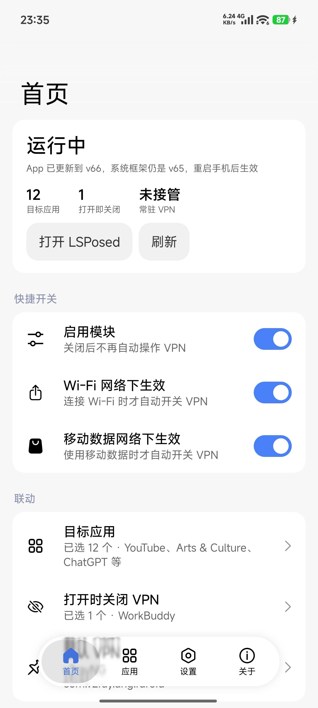
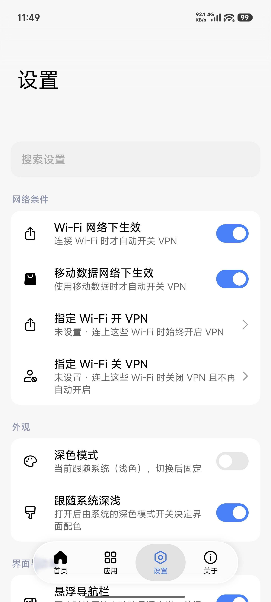
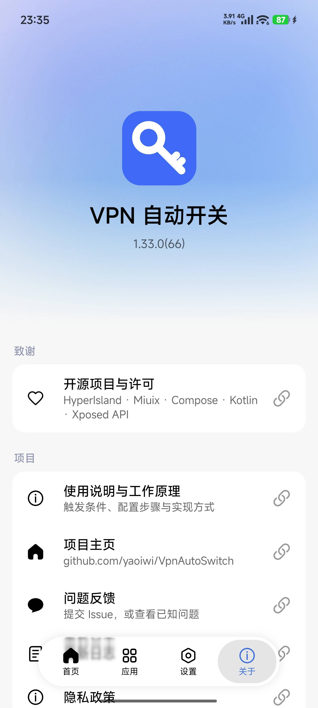

<p align="center">
  
</p>

<h1 align="center">VpnAutoSwitch</h1>

<p align="center">打开应用自动连接 VPN，划掉应用自动断开</p>
<p align="center">一个只注入 system_server 的 LSPosed 模块</p>

<p align="center">
  
  
  
  
  
  
  
</p>

<p align="center">
  <a href="README.md"></a>
  <a href="README_EN.md"></a>
</p>

---

## ✨ 功能简介

| **🎯 按应用联动** | **🛡️ 打开即关闭** |
| --- | --- |
| 打开目标应用自动连接 VPN<br>划掉应用任务、主进程结束自动断开 | 打开银行、支付、内网应用时<br>若 VPN 已连接立即断开，退出前不再自动连 |
| **📶 按 Wi-Fi 规则** | **🔍 一键自检** |
| 指定 Wi-Fi 强制开启或关闭 VPN<br>优先级高于目标应用与网络类型开关 | 检查模块心跳、LSPosed 作用域、客户端状态<br>当前命中规则、always-on 与最近失败 |
| **🧩 客户端适配** | **🪶 轻量 · 离线** |
| 优先走系统 always-on；兼容 Clash 系外部控制<br>新增适配向导，可测试并记住启动方式 | R8 后约 1.6 MB、单 dex<br>不联网、不上传，配置只保存在本机 |

---

## 📱 界面预览

| 首页 | 设置 | 关于 |
| --- | --- | --- |
|  |  |  |

---

## 📖 使用文档

1. 打开 [Release](https://github.com/yaoiwi/VpnAutoSwitch/releases/latest)，下载 `VpnAutoSwitch-1.42.0.apk`（覆盖安装即可，配置会保留）。
2. 打开 **LSPosed 管理器 → 模块**，启用本模块，**作用域只勾选「系统框架」**，然后重启手机。
3. 打开 App：
   - 「目标应用」选择需要自动连接 VPN 的应用；
   - 「打开时关闭 VPN」选择银行、支付等需要断网的应用（可留空）；
   - 「VPN 应用」选择你的客户端，打开「启用模块」；
   - 「客户端适配」可以检测客户端的启动方式，并测试外部控制 / VpnService。
4. 验证：打开目标应用出现 VPN 图标；从最近任务划掉应用，图标消失。
5. 可选：下拉快捷设置点「编辑」，把 **VPN 自动开关** 磁贴拖进面板。点按暂停 / 恢复自动联动；模块未运行时点按会打开 App。

> 手动在磁贴或客户端里断开后，模块不会立刻重连，只有真正重新打开目标应用才会恢复。
> 设置页「状态诊断 → 一键自检」可以定位大部分不生效问题。

遇到问题请提交 [Issue](https://github.com/yaoiwi/VpnAutoSwitch/issues)。

---

## 🔨 构建

需要 JDK 17 与 Android SDK 37：

```bash
./gradlew :app:test
./gradlew :app:assembleRelease
```

产物：`app/build/outputs/apk/release/app-release.apk`

---

## ⚠️ 注意事项

| 限制 | 说明 |
| --- | --- |
| 客户端要能被自动拉起 | 优先使用系统「始终开启的 VPN」；Clash 系走外部控制、重启 `VpnService` 或快捷磁贴。都不支持时需在客户端里打开「自动连接」，可先用「客户端适配」测试可用方式 |
| 手动连上的 VPN 需要强制停止 | 清除常驻设置不会断开手动连接，1.2 秒后仍连着会结束客户端进程（可在「高级」关闭） |
| 「划掉」默认即断开 | 从最近任务划掉目标应用后，即使前台服务让进程还活着也会断开；可在「高级」关闭「划掉任务即断开」，关闭后只有主进程结束才断开。任务回调不可用时仍按进程结束断开 |
| 与系统常驻 VPN 共用设置 | 模块开启期间该设置指向你的客户端，关闭时恢复原值；只对主用户生效，深度定制 ROM 可能需要按日志适配 |

---

## ⭐ Star History

[](https://star-history.com/#yaoiwi/VpnAutoSwitch&Date)

---

## 📄 许可证

本项目基于 [Apache License 2.0](LICENSE) 开源，欢迎提交 Issue 与 Pull Request。

<p align="center">Made with ❤️ for Android users</p>

<p align="center">
  <a href="https://github.com/yaoiwi/VpnAutoSwitch/stargazers">
    
  </a>
</p>
